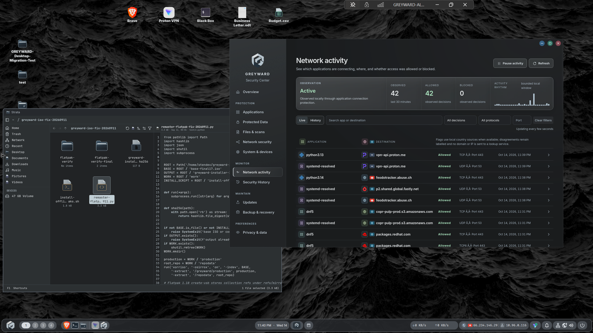
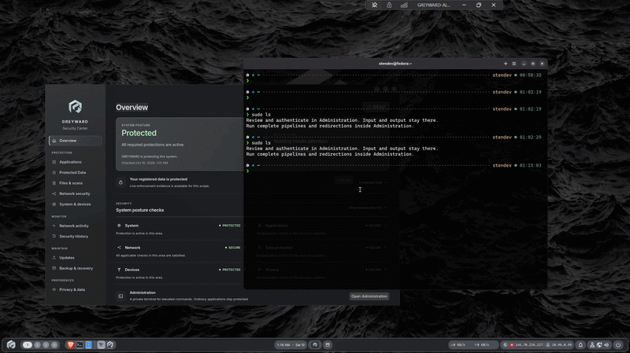
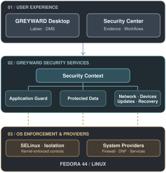
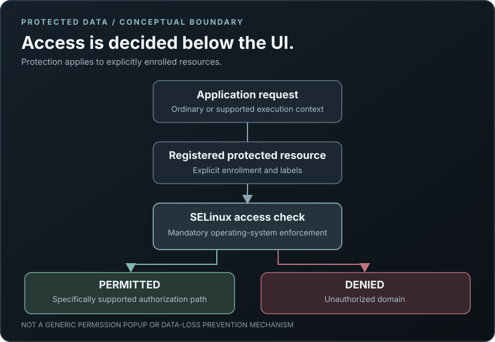
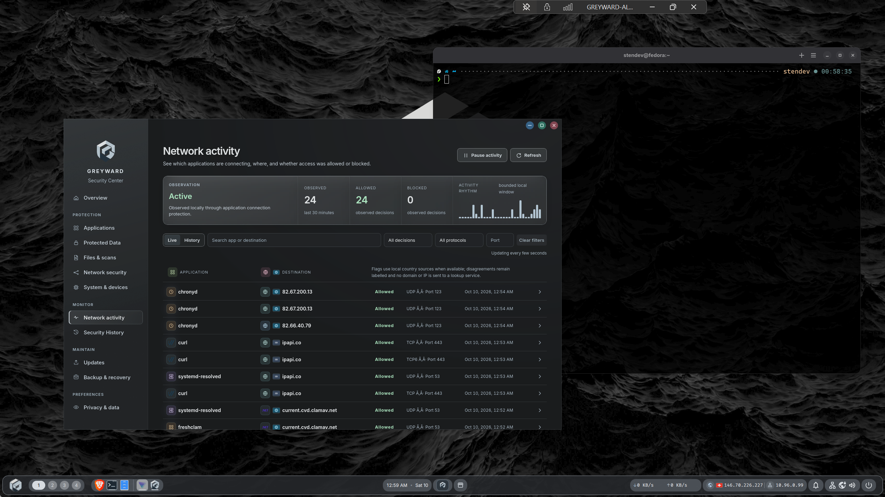
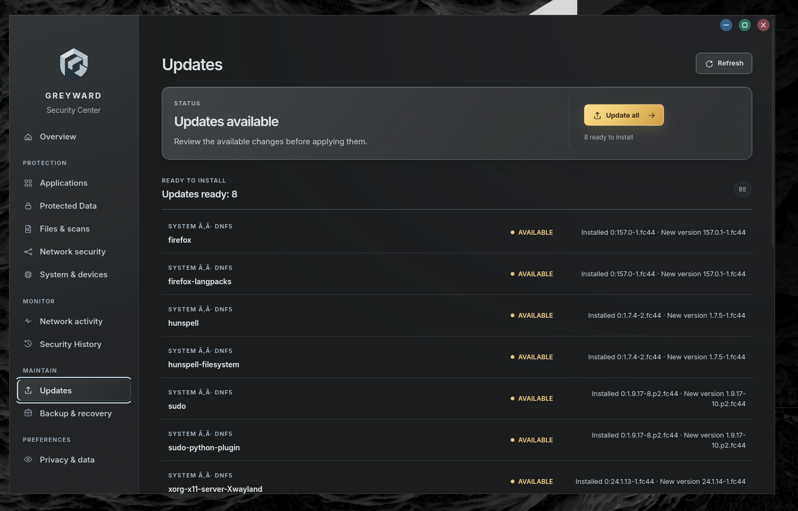
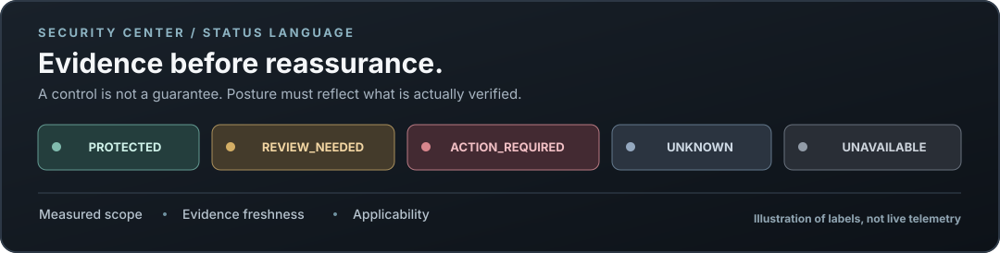
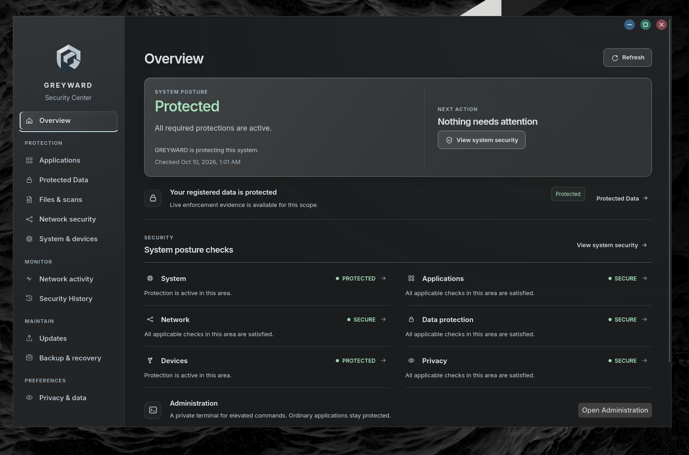
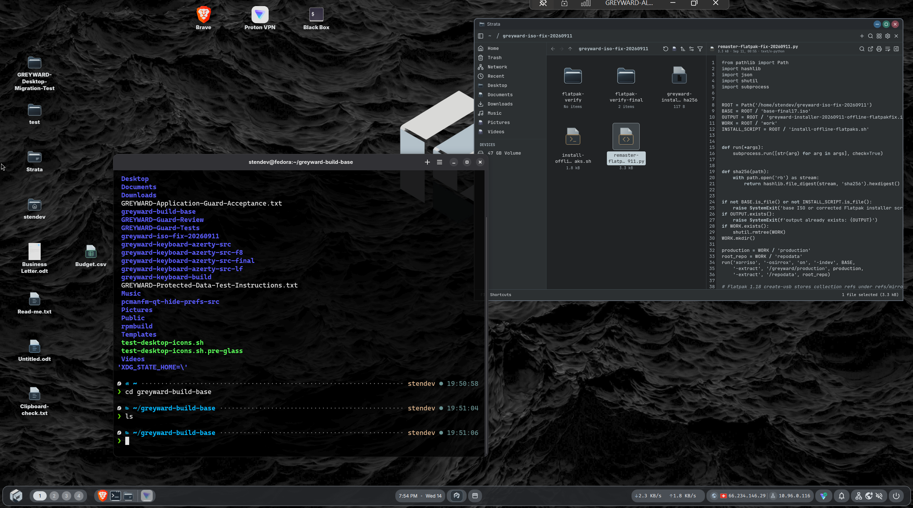

  

<h1 align="center">GREYWARD</h1>

  <strong>A Fedora-based desktop with integrated security controls and a distinct identity.</strong>

  
  
  
  

  Fedora 44 · Labwc · DankMaterialShell · Tauri 2 · Rust · Python · SELinux

  

  Latest linked published image: 0.3.8 Dawn. Features described below may reflect newer development builds and are not necessarily included in this ISO.

  <a href="docs/architecture/ISO_CREATION.md">Install &amp; test</a>
  · <a href="HARDWARE_TESTING.md">Hardware testing</a>
  · <a href="ARCHITECTURE.md">Architecture</a>
  · <a href="CONTRIBUTING.md">Contribute</a>

  <a href="#why-greyward">Why GREYWARD?</a>
  · <a href="#what-makes-it-different">Features</a>
  · <a href="#architecture-at-a-glance">Architecture</a>
  · <a href="#application-guard">Application Guard</a>
  · <a href="#protected-data">Protected Data</a>
  · <a href="#security-center">Security Center</a>
  · <a href="#a-desktop-of-its-own">Desktop</a>
  · <a href="#current-state-and-limitations">Status</a>

  

  

  

GREYWARD is a Fedora-based Linux distribution that brings together a distinctive Wayland desktop, Fedora's security foundations and an integrated Security Center.

Its goal is practical: **keep everyday computing familiar while adding explicit boundaries around sensitive data and administrative authority.**

Security Center brings application permissions, protected resources, network activity, file scanning, updates and recovery into one interface. Behind it, GREYWARD combines existing Linux services with its own policy and narrowly scoped privileged operations.

Application Guard connects application identity, supported execution controls and security activity. Protected Data adds SELinux access restrictions to explicitly registered resources. A separate Administration workflow provides deliberate access to elevated commands.

These capabilities have different scopes. Ordinary native applications are not universally isolated from one another, and general-purpose Allow once / Always allow permissions for arbitrary applications are not available.

> [!WARNING]
> **GREYWARD is pre-release software and has not received an independent security audit.** Development-system results do not establish equivalent behavior in every downloadable image or on every device. Read the [current limitations](#current-state-and-limitations) before testing.

# Why GREYWARD?

Linux already provides powerful security mechanisms. GREYWARD explores how to make them work together as a coherent desktop experience: understandable status, deliberate access to sensitive resources, practical administration and recoverable changes.

The aim is to reduce the security integration users must assemble themselves, while keeping the underlying system accessible and open to inspection.

The guiding principles are straightforward:

- **Familiar computing:** everyday applications and ordinary files should retain normal Fedora behavior wherever an additional boundary is unnecessary.
- **Meaningful protection:** registered sensitive resources receive operating-system access restrictions.
- **Deliberate authority:** supported exceptions and elevated operations should be explicit and attributable.
- **Visible evidence:** missing, stale or unavailable information must remain distinguishable from protection.
- **Coherent design:** desktop interactions, security controls and maintenance belong to the same product experience.

# What makes it different?

| Feature | What it brings |
| --- | --- |
| **Security Center** | One place to understand security state, review activity and use supported controls. |
| **Protected Data** | SELinux restrictions for explicitly registered sensitive resources, beyond ordinary Unix file permissions. |
| **Application Guard** | Application identity, supported managed execution and application-related security activity. |
| **Administration** | A protected workflow for reviewing and authenticating elevated commands. |
| **Network & devices** | Integrated application networking, firewall zones, managed DNS and USBGuard visibility. |
| **Files & maintenance** | Scanning, quarantine, Safe Open, updates, recovery points and personal backup workflows. |
| **GREYWARD desktop** | Labwc, an adapted DankMaterialShell and GREYWARD Files, with a shared visual identity. |

These features have different implementation and validation levels; the [status table](#current-state-and-limitations) describes their limits.

# Architecture at a glance

GREYWARD builds on Fedora and separates **presentation, evidence, privileged decisions and kernel enforcement**.

  

The diagram summarizes responsibilities; individual operations may take different paths.

Security Center runs as the logged-in user. Its Tauri interface and Security Context call named operations rather than exposing a generic root shell. Privileged services validate supported requests; authoritative providers and the kernel apply the corresponding controls.

The kernel, loaded policy, broker, protected authentication/display components and package inputs remain trusted. A compromised provider can undermine the protection or evidence it owns. See the [architecture](ARCHITECTURE.md) and [privilege model](docs/security/privilege-model.md) for the detailed boundaries.

# Application Guard

Application Guard connects **application identity → protection → permissions → protected resources → activity**.

Development builds include root-controlled policy, live requester checks and supported managed launches. The native managed runner uses namespaces, Landlock and seccomp; bounded script, AppImage and selected-file workflows reuse that infrastructure.

**Managed confinement does not automatically cover every normally launched native program.** Flatpaks retain their upstream sandbox, manifest and override permissions. Generic reviewed access for arbitrary applications, interpreters and Flatpaks remains unavailable.

# Protected Data

Applications sharing a Unix user normally share access to much of that user's data. Protected Data adds a mandatory SELinux boundary around **explicitly registered resources** in an enrolled session.

  

SELinux denies unauthorized access independently of Security Center. Registration is explicit: protecting one folder does not protect every credential or document on the machine.

A supported exception must identify the executable generation, resource, operation and workload. Historical denials, application-supplied names or forwarded portal identifiers cannot establish authorization by themselves.

A narrow, read-only, non-exporting key-inspection workflow has been tested. It does **not** provide general SSH authentication, GPG signing, IDE key access or protected-document editing. Arbitrary denied file operations cannot be paused and resumed through a permission dialog.

Protected Data is access control, not encryption or data-loss prevention. Revocation cannot recover data already read or copied.

# Protected authentication and Administration

Enrolled development sessions separate sensitive authentication and display components from ordinary applications. Routine product operations use bounded service actions; interactive administration follows a separate protected path.

An ordinary terminal's sudo request is handed to an Administration surface for review and authentication. Inside that terminal, packaged sudo supports familiar commands and root shells, with a **two-minute terminal-scoped authentication cache**. Cache expiry does not end an existing root shell.

Elevated commands can read protected data and change or disable security controls. Keeping this authority deliberate preserves ownership of the machine without making it available automatically to ordinary applications. Some older privileged interfaces still require authorization review; this is not a claim that every service follows the newer boundary.

# Security Center

Security Center makes security state, supported actions and failures understandable in the context of everyday use.

| Network Activity | Unified Updates |
| :---: | :---: |
|  |  |

| Area | What users can inspect or manage |
| --- | --- |
| **System & applications** | System posture, application identity, effective Flatpak permissions and supported Guard workflows. |
| **Protected Data & activity** | Registered-resource status, supported reviews and application-related events. |
| **Network** | OpenSnitch application policy, firewalld zones, NetworkManager connections, managed DNS and VPN-aware reconciliation. |
| **Files & scans** | ClamAV scanning, file provenance, quarantine/restore and Safe Open. |
| **Updates** | DNF5, Flatpak, fwupd and ClamAV database updates. |
| **Devices** | USBGuard state/history and selected camera/microphone activity observations. |
| **Recovery** | Btrfs recovery points and Restic-backed personal backup workflows. |

Security information should stay visible without taking over the desktop.

### Evidence before reassurance

Status reflects the scope and freshness of available evidence. Unknown, unavailable and degraded states remain distinct from an active protection. Acknowledging a finding does not activate a missing control.

  

The diagram illustrates the reporting principle; individual controls use their own evidence.

A running service or green label is not an end-to-end security test. ClamAV definitions do not establish real-time scanning; a connected VPN does not establish a working kill switch or absence of DNS leaks. Collectors and wording also need validation against actual behavior.

# Security gets interesting when systems interact

GREYWARD integrates existing providers instead of replacing their responsibilities. For example, DNS policy must accommodate legitimate VPN resolvers without allowing arbitrary resolver bypass. The current service reconciles observed network state with scoped policy; VPN failover and leak resistance require separate validation.

The same principle guides updates, device admission and recovery: report the provider's result, preserve uncertainty and verify the intended outcome.

# A desktop of its own

The desktop is part of GREYWARD's identity: obsidian and graphite surfaces, restrained silver accents, controlled transparency and readable typography.

Labwc provides the Wayland compositor, UWSM manages the session and an adapted DankMaterialShell provides the shell and settings. GREYWARD Files integrates Strata with the shared file-icon family; PCManFM-Qt handles desktop icons, while DMS owns the wallpaper.

  

The terminal and underlying Fedora system remain accessible. Compatibility, accessibility, multiple displays and reliable session behavior remain development priorities alongside visual consistency.

# Security and usability are a trade-off

Normal desktop work should not require understanding SELinux. Additional restrictions need a meaningful benefit, an understandable explanation and a practical supported workflow. Accidental compatibility regressions should be fixed; intentional protected-resource boundaries should not be silently removed.

Unsupported access remains denied rather than falling back to unrestricted execution. Recovery and administrative ownership must be considered alongside enforcement.

# Current state and limitations

**The following describes development capabilities, not acceptance of the linked ISO.** Feature availability depends on image and component versions. Consult [development status](docs/STATUS.md), the [testing guide](TESTING.md) and the release information accompanying your download.

| Capability | Current evidence and remaining limits |
| --- | --- |
| **Desktop & Security Center** | Implemented in development. Files integration has selected real-desktop checks; broader hardware and everyday compatibility remain incomplete. |
| **SELinux & Protected Data** | Enforcing policy, registered-resource denials and bounded reviewed grants have development evidence. Resource coverage and legitimate access workflows remain limited. |
| **Application Guard** | Broker and supported managed launches are implemented with bounded tests. Ordinary same-user applications are not universally separated. |
| **Generic application permissions** | **Not delivered:** arbitrary native/script/Flatpak Allow once / Always allow, including normal protected-document open/edit/save/reopen. |
| **Authentication & Administration** | Separate domains and administration workflows have development evidence. Package presence does not establish clean-install, upgrade, lock/unlock, stability or offline-recovery acceptance. |
| **D-Bus inspection isolation** | Selected restrictions tested in a development overlay; release packaging and clean-install acceptance remain separate. |
| **Network & devices** | OpenSnitch, firewalld, managed DNS and USBGuard are integrated. Authorization assurance, VPN leak/failover and physical-device tests remain incomplete. |
| **Scanning, updates & recovery** | Implemented workflows have partial validation. Full scan/status acceptance, rollback, backup restore and offline repair remain open. |
| **Screen sharing** | Known broken or unavailable in the audited environment; portal/compositor repair is pending. |
| **Secure Boot & TPM** | Protection is not established by the audited VM; hardware-specific verification is required. |
| **Installation & images** | An installer and image pipeline exist. Composition checks do not establish clean-install or security acceptance for a new candidate. |

Default outbound networking is not a general anti-exfiltration boundary. Malware signatures cannot guarantee detection, and snapshots do not replace tested backups. See the [threat model](THREAT_MODEL.md) for assumptions and exclusions.

Current priorities are compatibility, truthful status, supported sensitive-resource access, privileged-service review, clean-install validation and tested recovery. Wider hardware, suspend/resume and accessibility coverage also remain open.

Screenshots show development builds; appearance is not release or security acceptance.

# Open development

GREYWARD is an independent, one-person project developed in the open. Simpler upstream mechanisms and contributions that remove unnecessary complexity are welcome.

# Contribute

Useful contributions include reproducible compatibility reports, hardware tests, architecture and security review, accessibility improvements and focused fixes. Fedora, SELinux, Wayland, Rust, Python and packaging experience are especially valuable.

See [CONTRIBUTING.md](CONTRIBUTING.md) to get involved. Follow [SECURITY.md](SECURITY.md) for vulnerability reports.

# AI disclosure

Most of GREYWARD's code has been written with **AI coding agents**. The maintainer is not a professional software developer or security researcher. Implementation and testing do not replace experienced human review or an independent security audit.

Contributions that improve correctness, simplicity, compatibility and security are especially welcome.

# Repository and technical references

Start with the [documentation index](docs/INDEX.md) and [repository map](docs/REPOSITORY_MAP.md). Installed-system definitions live in `environment/production/`, Security Center and Context in `security-center/`, RPM definitions in `packaging/`, and visual sources in `branding/`.

See [TESTING.md](TESTING.md) and the [Security Center guide](security-center/README.md) for validation commands. [Hardware testing](HARDWARE_TESTING.md), the [architecture](ARCHITECTURE.md) and [privilege model](docs/security/privilege-model.md) describe the corresponding scope and evidence.

# Licensing

GREYWARD-authored **source code and documentation** are licensed under [`GPL-3.0-only`](LICENSE), except where explicitly stated otherwise.

Third-party software and assets retain their respective licenses. See [`THIRD_PARTY_NOTICES.md`](THIRD_PARTY_NOTICES.md).

The **GREYWARD and MANTIS SYSTEMS names, logos, visual identity and designated branding assets are not licensed for general reuse under GPL solely because they are stored in this repository**.

See [`LICENSING.md`](LICENSING.md) for branding and naming terms.

---

  Stronger defaults · Enforceable boundaries · Visible evidence · Distinct desktop · Open to challenge

